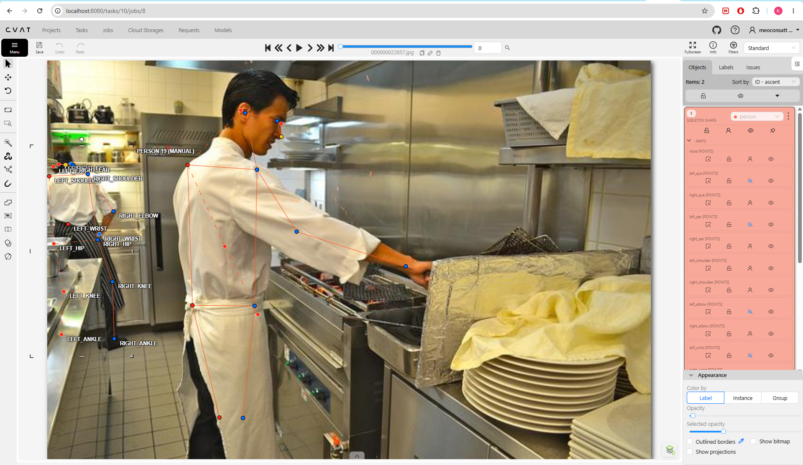
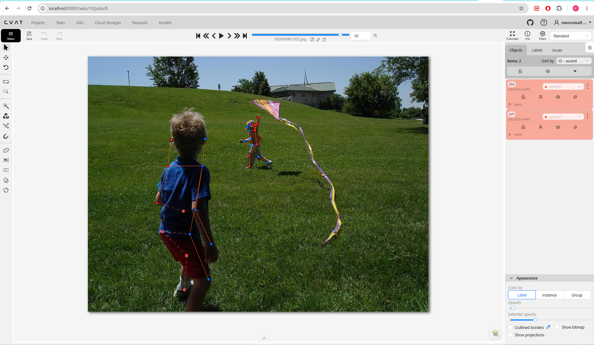
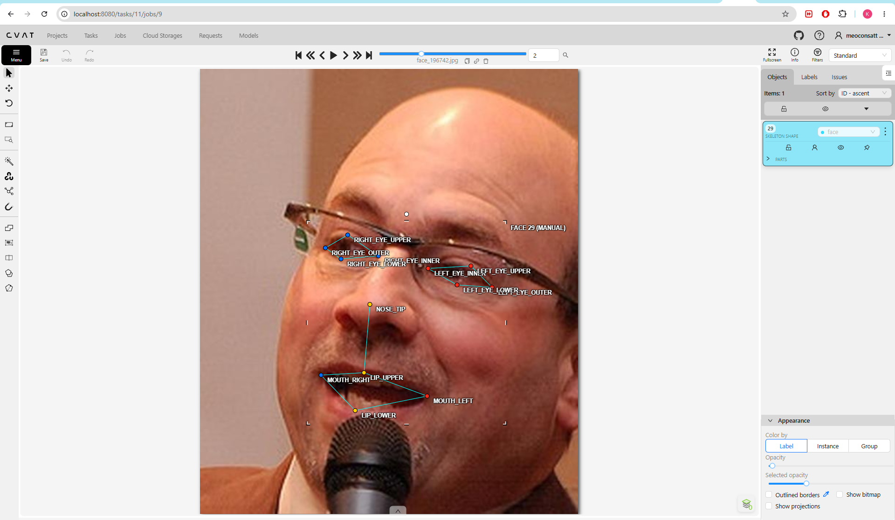
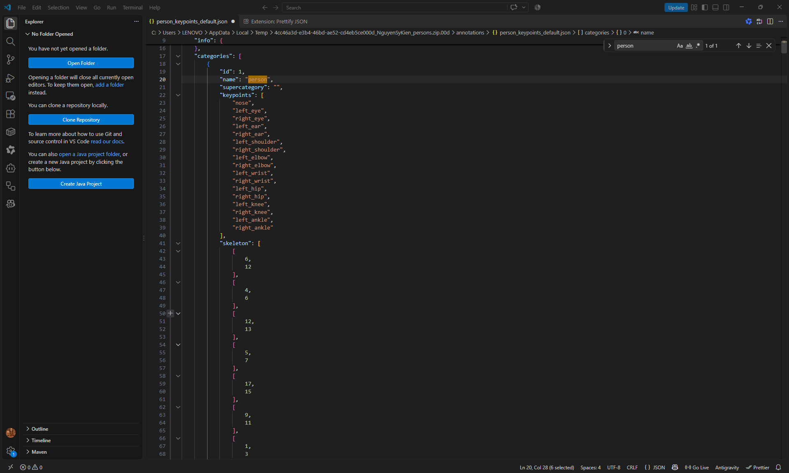

# Báo cáo cá nhân — 2A202603245_NguyenSyKien

Dữ liệu: 12 ảnh người COCO val2017 (Lin et al., 2014) và 8 ảnh chân dung Wikimedia Commons, chỉ dùng trong lớp.

## 0. Thông tin học viên

- Họ tên: Nguyễn Sỹ Kiên
- MSSV: 2A202603245
- Email: 26ai.kienns@vinuni.edu.vn
- Link repository: https://github.com/justAchillGuy8386/K5-L2-Day04-NguyenSyKien-2A202603245-KeypointPose-Student
- Phiên bản CVAT (Help → About): CVAT 2.74.1 (Community Edition)
- Máy: hệ điều hành Windows 11 · RAM 16 GB (Docker cấp phát 6.7 GB) · chạy CVAT chế độ đầy đủ
- Bộ ảnh (`src/exports/assignment.json` do `lab.py setup` tạo): có
- Giờ bắt đầu: 16:30
- Giờ kết thúc: 19:30

## 1. Kiểm tra label (CP0)

| Label | Kiểu | Số điểm | Tên điểm đúng bảng của lab? | Đúng thứ tự? | Số cạnh |
|---|---|---:|---|---|---:|
| `person` | Skeleton | 17 | Có | Có | 19 |
| `face` | Skeleton | 13 | Có | Có | 13 |

Mẫu `person` dựng theo người quay mặt về camera (các điểm `left_*` nằm bên phải khung mẫu)? Có

Cách đổi cờ `occluded` / `outside` cho **một điểm** trên phiên bản CVAT này (một câu):
Nhấp chọn điểm cần đổi trên skeleton (hoặc mở rộng skeleton trong bảng Objects ở cột bên phải), sau đó tích chọn ô `Occluded` để đánh dấu điểm bị che khuất (`v = 1`) hoặc `Outside` để đánh dấu điểm nằm ngoài khung ảnh/không xác định (`v = 0`).

## 2. Số lượng đã gán và thời gian (CP1, CP2)

| Nhóm ảnh | Số ảnh | Số skeleton đã gán | Số người dưới 60 px (không gán) | Số poster / gương / màn hình bỏ qua | Thời gian (phút) |
|---|---:|---:|---:|---:|---:|
| `easy` | 5 | 5 | 0 | 0 | 25 |
| `occluded` | 3 | 6 | 0 | 0 | 25 |
| `back` | 2 | 4 | 0 | 0 | 20 |
| `small` | 1 | 1 | 1 | 0 | 10 |
| `crowd` | 1 | 3 | 2 | 0 | 15 |
| `faces` | 8 | 8 | — | 0 | 25 |

- Số ảnh người đã xong ở mốc phút 105: 10 / 10
- Thời gian thực tế (phút): CP1 95 · CP2 25 · CP3 20
- Ảnh tốn thời gian nhất là ảnh nào, vì sao?
Ảnh tốn nhiều thời gian nhất là `000000542160.jpg` (nhóm crowd) và `000000022857.jpg` (nhóm back có vật che khuất), do có nhiều người đứng gần nhau, các chi và khớp bị che khuất đan xen phức tạp; cần phải phóng to tối đa, lần theo từng đoạn xương giải phẫu (từ vai xuống khuỷu, cổ tay và từ hông xuống gối, cổ chân) để xác định chính xác người nào sở hữu chi nào và cờ visibility tương ứng.

## 3. Bảng ca khó (CP1, CP2)

Mỗi điểm bạn phân vân một dòng, nhất là phân vân giữa `v = 1` và `v = 0`, hoặc không chắc hướng người.

| Ảnh | Người / mặt | Điểm | Cờ đã chọn | Phân vân giữa | Lý do chọn |
|---|---|---|---:|---|---|
| `000000022857.jpg` | Người #0 (quay lưng) | `left_ankle` | 0 | v = 1 và v = 0 | Chân trái bị che khuất hoàn toàn phía sau vật cản, không có đoạn cẳng chân lộ ra để ngoại suy chắc chắn nên chọn `outside` (`v = 0`) để tránh đoán mò làm sai loss |
| `000000461002.jpg` | Người #1 (quay lưng) | `nose` | 0 | v = 1 và v = 0 | Người quay lưng góc nghiêng lớn, khuôn mặt bị che khuất hoàn toàn sau gáy/tóc, không thể ước lượng chắc chắn tọa độ mũi nên chọn `outside` (`v = 0`) |
| `000000189365.jpg` | Người #1 (bị che) | `right_wrist` | 1 | v = 1 và v = 0 | Cổ tay phải bị mép áo/vật cản che nhưng thấy rõ vị trí khuỷu tay và hướng cẳng tay, vị trí khớp cổ tay có thể ước lượng chắc chắn trong phạm vi sai số nhỏ nên chọn `occluded` (`v = 1`) |
| `face_415073.jpg` | Mặt #0 (nghiêng) | `left_eye_inner` | 1 | v = 2 và v = 1 | Mặt nghiêng góc hẹp, sống mũi che một phần khóe trong mắt trái nhưng con ngươi và mí mắt vẫn thấy rõ, ước lượng chắc chắn được vị trí khóe trong nên chọn `occluded` (`v = 1`) |
| `face_256814.jpg` | Mặt #0 (kính râm) | 4 điểm quanh mắt | 1 | v = 2 và v = 1 | Tròng kính râm tối màu che mắt, theo guideline phải đặt các điểm mí và khóe mắt sau tròng kính theo khung gọng kính và gán cờ `occluded` (`v = 1`) |

## 4. Bảng tự review (CP3)

Đi từ ảnh cuối về ảnh đầu. 5 ảnh người (ít nhất 2 ảnh `back` hoặc `crowd`) và 3 ảnh mặt. Ít nhất 8 dòng, kể cả dòng `ok`. Ghi lỗi trước, sửa sau.

Mã lỗi dùng đúng một trong: `lr_swap`, `vis_flag`, `position`, `missing`, `extra`, `ok`.

| Ảnh | Người / mặt | Điểm | Mã lỗi | Ghi chú | Đã sửa? |
|---|---|---|---|---|---|
| `000000542160.jpg` | Người #2 (đám đông) | `left_knee`, `right_knee` | `lr_swap` | Hai chân bắt chéo nhau, ban đầu nhầm gối trái sang chân bên phải ảnh, đã kiểm tra hướng cơ thể và đổi lại đúng cặp trái/phải | Có |
| `000000461002.jpg` | Người #1 (quay lưng) | `nose`, `left_eye` | `vis_flag` | Người quay lưng hoàn toàn nhưng để cờ mặc định v=2, đã chuyển sang `outside` (`v = 0`) vì không thấy mặt | Có |
| `000000323705.jpg` | Người ở hậu cảnh | Toàn bộ | `extra` | Có một người ở xa chiều cao chỉ ~45 px (< 60 px), đã xóa skeleton thừa theo đúng quy tắc | Có |
| `000000022857.jpg` | Người #0 (quay lưng) | `left_hip`, `right_hip` | `position` | Khớp hông đặt lệch lên cạp quần, đã kéo lại vào đúng tâm khớp xương chậu | Có |
| `000000311497.jpg` | Người #1 (bị che) | Toàn bộ | `ok` | Khớp và cờ visibility đều được đặt chính xác, các đoạn chi nối hợp lý | Có (ok) |
| `000000156069.jpg` | Người #0 (thẳng) | `nose`, `left_eye`, `right_eye` | `position` | Phóng to phát hiện tâm mắt hơi lệch khỏi con ngươi, đã căn chỉnh lại chính xác | Có |
| `face_79367.jpg` | Mặt #0 (tóc che) | Toàn bộ | `ok` | 13 điểm mí mắt, khóe mắt, khóe miệng và chóp mũi đã đặt chuẩn mép | Có (ok) |
| `face_415073.jpg` | Mặt #0 (nghiêng) | `left_eye_inner` | `vis_flag` | Khóe trong mắt trái bị sống mũi che một phần nhưng chưa bật cờ occluded, đã chuyển sang `occluded` (`v = 1`) | Có |
| `face_256814.jpg` | Mặt #0 (kính râm) | `left_eye_*`, `right_eye_*` | `vis_flag` | 4 điểm mắt sau kính râm tối màu ban đầu để v=2, đã chuyển thành `occluded` (`v = 1`) theo guideline | Có |

Tổng hợp số lỗi theo mã:

| `lr_swap` | `vis_flag` | `position` | `missing` | `extra` | `ok` |
|---:|---:|---:|---:|---:|---:|
| 1 | 3 | 2 | 0 | 1 | 2 |

Điểm còn phân vân giữa `v = 1` và `v = 0` (ghi cả hai lựa chọn và lý do chọn):
Tại ảnh `000000022857.jpg`, điểm `left_ankle` của người quay lưng: Phân vân giữa `v = 1` (ước lượng theo hướng cẳng chân) và `v = 0` (bị che hoàn toàn). Quyết định chọn `v = 0` (`outside`) vì độ dài cẳng chân bên dưới không xác định được khi chân đang co/gập, chọn `v = 0` đảm bảo không đưa điểm đoán bừa vào tính loss khi huấn luyện model.

## 5. Kiểm file xuất và kết quả tự kiểm (CP4)

Tự kiểm tay trong file JSON:

| File | Người / mặt kiểm (ảnh, thứ tự) | Số phần tử `keypoints` | Điểm `outside` ra `v = 0`, `occluded` ra `v = 1`? | `num_keypoints` khớp? |
|---|---|---:|---|---|
| `NguyenSyKien_persons.zip` | `000000022857.jpg` (người #0) | 51 | Điểm ngoài ảnh ra `v = 0` (2 điểm), bị che ra `v = 1` (4 điểm) | Khớp (15 = 11 + 4) |
| `NguyenSyKien_persons.zip` | `000000461002.jpg` (người #1) | 51 | Điểm ngoài ảnh ra `v = 0` (4 điểm), bị che ra `v = 1` (4 điểm) | Khớp (13 = 9 + 4) |
| `NguyenSyKien_faces.zip` | `face_415073.jpg` (mặt #5) | 39 | Điểm bị che ra `v = 1` (1 điểm), không có điểm `outside` | Khớp (13 = 12 + 1) |

Sau khi xuất, CVAT ghi `occluded` thành `v = 1` và `outside` thành `v = 0`. Tọa độ của điểm `outside` trong file là tọa độ cũ.

Hai job đã chuyển sang completed trên CVAT? Có

Dán phần **TÓM TẮT** in ra từ `src/check_submission.py`:

```text
- File person: NguyenSyKien_persons.zip
  Số ảnh: 12 · số skeleton `person`: 19 · mỗi annotation 51 số
  Skeleton theo ảnh: 000000022857=2, 000000156069=1, 000000156986=2, 000000175703=1, 000000189365=2, 000000194027=1, 000000311497=2, 000000314154=1, 000000323705=1, 000000336477=1, 000000461002=2, 000000542160=3
  Cờ v: v=2 246 (76%) · v=1 50 (15%) · v=0 27 (8%)
  num_keypoints trung bình: 15.6
- File face: NguyenSyKien_faces.zip
  Số ảnh: 8 · số skeleton `face`: 8 · mỗi annotation 39 số
  Skeleton theo ảnh: face_137371=1, face_155465=1, face_196742=1, face_232598=1, face_256814=1, face_415073=1, face_421231=1, face_79367=1
  Cờ v: v=2 103 (99%) · v=1 1 (1%) · v=0 0 (0%)
  num_keypoints trung bình: 13.0
- Ghi chú: 27 điểm v = 0 vẫn mang tọa độ cũ (CVAT 2.x xuất như vậy; chuẩn COCO ghi 0, 0). Không phải lỗi: điểm v = 0 bị bỏ qua khi huấn luyện và khi chấm.
- Số [LỖI]: 0 · số [CẢNH BÁO]: 2
Kết quả: ĐẠT (đọc lại từng cảnh báo ở trên)
```

Các `[CẢNH BÁO]` còn giữ nguyên và lý do:
- Cảnh báo tại ảnh `000000461002.jpg #1` và `000000542160.jpg #2` ("cặp knee, ankle nằm ngược phía so với các cặp còn lại"): Sau khi kiểm tra đối chiếu trực tiếp trên ảnh gốc, đây là tư thế người ngồi/đứng bắt chéo chân tự nhiên trong cảnh thực tế (chân phải bắt chéo sang bên trái cơ thể). Các khớp gối và cổ chân đã được đặt đúng theo giải phẫu cơ thể của nhân vật (tuân thủ quy tắc trái/phải theo nhân vật), không phải lỗi nhầm lẫn trái/phải (`lr_swap`), vì vậy giữ nguyên.

## 6. Ảnh chụp màn hình

1. Label `person` trong label constructor (đủ 17 điểm có tên):

   

2. Một người quay lưng đã gán, cờ đã đặt:

   

3. Một khuôn mặt đã gán 13 điểm, phóng to vùng mắt:

   

4. Một đoạn JSON xuất của một người:

   

Nguồn ảnh: COCO val2017 / Wikimedia Commons.

## 7. Tự đánh giá

1. Lỗi bạn mắc nhiều nhất hôm nay, và cách bạn sẽ tránh ở dự án thật:
   Lỗi dễ mắc nhất là nhầm lẫn trái/phải (`lr_swap`) khi đối tượng quay lưng hoặc đứng nghiêng góc hẹp do thói quen nhìn theo góc nhìn người xem (viewer-centric) thay vì người trong ảnh (subject-centric). Cách tránh ở dự án thật: Luôn định hình hướng nhìn của nhân vật trước khi đặt điểm, nếu đối tượng quay lưng thì hoán đổi toàn bộ các điểm `left_*` sang bên trái ảnh ngay từ đầu trước khi tinh chỉnh; kiểm tra các đường nối chi xem có bị chéo bất thường không.

2. Một quy tắc bạn đề xuất thêm vào guideline (kèm ảnh ví dụ nếu có):
   Đề xuất quy tắc rõ ràng đối với các khớp bị che khuất bởi trang phục rộng thùng thình (áo khoác mùa đông dày, váy dài trùm chân): Nếu biên dạng cơ thể không thể ngoại suy chắc chắn vị trí khớp xương trong phạm vi dung sai hẹp (dưới 10-15 px), bắt buộc phải gán `outside` (`v = 0`) thay vì cho phép gắn `occluded` (`v = 1`), tránh tình trạng người gán nhãn đoán mò tâm khớp gây nhiễu phân phối heatmap ground truth của mô hình.

3. Nhãn của bạn đi vào model ở đâu? Chọn một lỗi bạn đã sửa và nói nó sẽ làm model học sai thế nào (heatmap, trọng số trong loss, hay bước lật ảnh):
   Nhãn keypoint được dùng để tạo các bản đồ nhiệt Gaussian 2D (Ground Truth Heatmaps) và cờ visibility quyết định trọng số trong hàm loss (điểm `v > 0` có trọng số 1, điểm `v = 0` có trọng số 0). Nếu không sửa lỗi hoán đổi trái/phải (`lr_swap`) ở chân/tay, trong bước tăng cường dữ liệu (Horizontal Flip Augmentation) các điểm trái/phải bị đảo ngược tên, mô hình sẽ bị phạt loss vô lý và học cách dự đoán đỉnh heatmap ở vị trí đối xứng, làm sụp đổ hoàn toàn điểm tương đồng OKS (Object Keypoint Similarity) khi đánh giá.

## 8. Khó khăn và lỗi kỹ thuật

- Lỗi kỹ thuật môi trường: Ban đầu khi chạy `python lab.py check` trên Windows PowerShell gặp lỗi `NotADirectoryError: [WinError 267]` do CVAT được cài trong WSL Ubuntu (`/home/kiennguyen/cvat-day2`) khiến Python trên Windows không thể chuyển `cwd` sang đường dẫn POSIX, đồng thời thiếu filter nhận diện container `nuclio`. Đã khắc phục bằng cách thiết lập `wsl -s Ubuntu` và bổ sung xử lý đường dẫn WSL trong `lab.py`.
- Khó khăn thao tác: Ảnh đám đông (`crowd`) có nhiều người đứng chen chúc, chân và tay bị che khuất đan xen, cần phải phóng to tối đa và lần theo từng khớp xương để không nối nhầm chi của người này sang người khác.

## 9. Tài liệu tham khảo và công cụ AI đã dùng

- COCO Dataset: Guidelines & Metrics (Object Keypoint Similarity - OKS).
- Tài liệu hướng dẫn bài lab: `docs/GUIDELINE.md`, `docs/CVAT_CHEATSHEET.md`, `docs/COCO_KEYPOINTS.md`.
